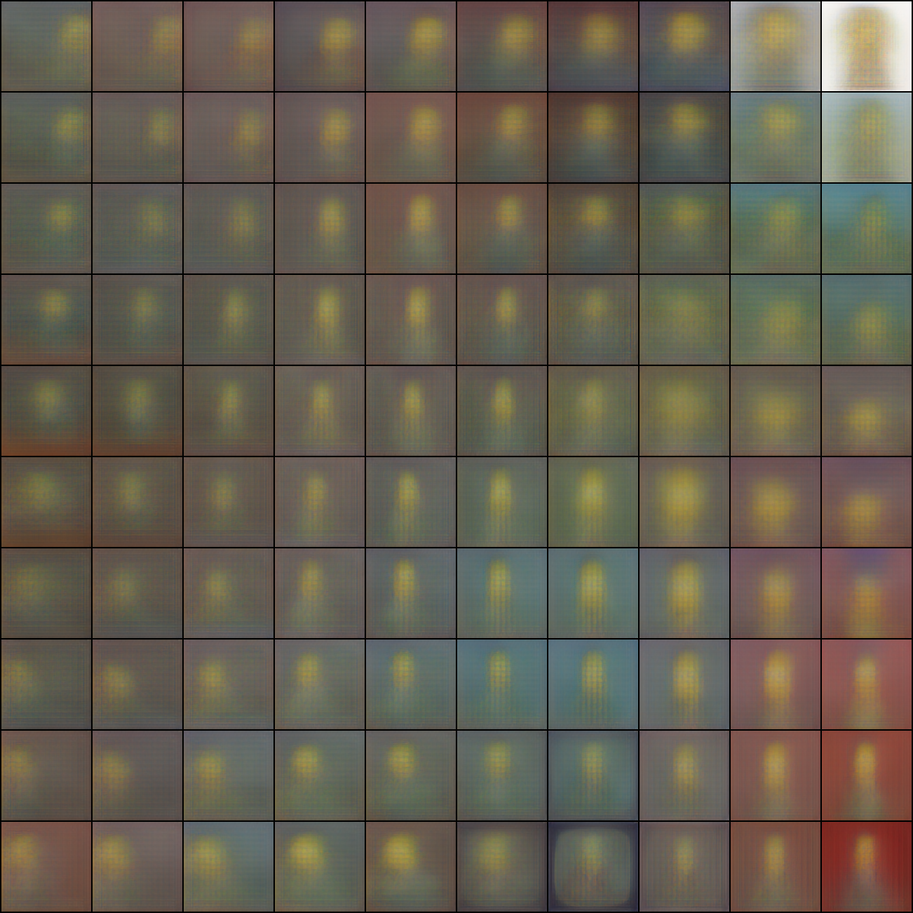

# Simple VAE SOM

A simple Torch-based self-organizing map (SOM) that creates a topology over images using the latents of a tiny VAE.



## Usage

```shell
uv sync
uv run src/som/main.py simpsons_dataset -c 10 -r 10 -e 10
```